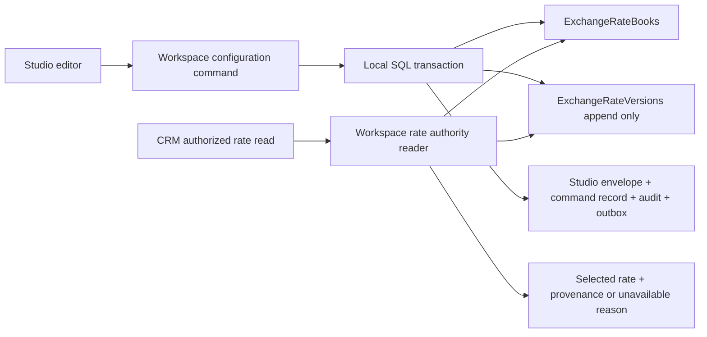

# Phase 2 — Exchange Rate Authority: thiết kế để review

Review revision: **22/10/2026**, Asia/Saigon. **Hướng kiến trúc đã được người dùng chấp thuận; chi tiết bổ sung vẫn PROPOSED — IMPLEMENTATION NOT AUTHORIZED.** Chưa sửa production code, OpenAPI, capability catalog, migration hoặc database. Bản trước review được giữ nguyên byte trong [design-before-review.md](evidence/multicurrency-phase2-review-20261022/design-before-review.md); không sửa evidence cũ để che thay đổi thiết kế.

Bộ tài liệu chi tiết hiện hành: [Database constraints và chứng minh uniqueness/version](multicurrency-phase2-database-integrity-proposal.md), [contract change proposal riêng](multicurrency-phase2-contract-change-proposal.md), [UX, migration/cutover, acceptance matrix, file/pin impact và PR dependencies](multicurrency-phase2-delivery-and-acceptance-plan.md). Các tài liệu này thay phần đề xuất tương ứng của bản trước. Quyết định đã chốt và gaps còn lại ở mục 12 dưới đây.

Người dùng đã chấp thuận chức năng CF01 trong phạm vi kiểm thử Phase 1. Chấp thuận đó không phải Git checkpoint approval, quality waiver hoặc production release acceptance. Checkpoint Phase 1 vẫn **PROPOSED_NOT_APPROVED**; mọi FAIL/BLOCKED/NOT_RUN trước đó giữ nguyên. Ghi nhận mới nằm trong [review record riêng](evidence/multicurrency-phase2-design-20261021/cf01-functional-review-record.json); không sửa lại evidence Phase 1.

## 1. Khuyến nghị

Giữ Exchange Rate Authority trong module Workspace/WorkspaceConfiguration hiện có, cùng ApiHost và SQL Server. Studio là giao diện nhập/cấu hình; CRM đọc một projection/resolver riêng có quyền phù hợp. Dùng **hai bảng nhỏ** cho sổ tỷ giá và phiên bản tỷ giá bất biến; tận dụng command idempotency, Studio envelope concurrency, audit, outbox và transaction pattern hiện hữu. Không tạo microservice, scheduler lấy giá, provider adapter, event-sourcing framework hay conversion engine.

Phạm vi implementation tương lai nên gồm: nhập tỷ giá **MANUAL**, kiểm tra/lưu phiên bản, lịch sử, quyền truy cập và chọn **tỷ giá trực tiếp** theo thời điểm. Resolver chỉ trả rate/provenance hoặc lý do không có authority; không nhân amount, làm tròn Money, chuyển đổi giao dịch hay sửa Dashboard/Product.

Review đã chốt expiry bắt buộc/end-exclusive, saved-rate effectiveness không phụ thuộc Publish và append-only historical correction/withdrawal. Permission/DTO được cụ thể hóa theo hướng review: trusted membership + workspace.context.resolve cho CRM narrow resolver, giữ Studio permissions riêng. Numeric precision cuối, time-entry/selection details, bridge compatibility và actual legacy inventory vẫn phải qua các gate mục 12; không suy diễn từ UI hiện tại.

## 2. AnalysisRecord: sự thật và authority gap

Phân loại: **CANONICAL_FACT** = yêu cầu người dùng hoặc current contract rõ; **OBSERVED_FACT** = source/SQL quan sát được; **DERIVED_FACT** = hệ quả có nguồn; **PROPOSAL** = chưa duyệt; **AUTHORITY_GAP** = cần quyết định trước implementation phụ thuộc nó.

| ID / loại | Kết luận và evidence |
|---|---|
| F01 CANONICAL_FACT | Amount/currency gốc phải bất biến; đổi base không reprice hay rewrite transaction. Backend USD/demo VND giữ nguyên; user giới hạn Phase 2 hiện tại chỉ thiết kế. |
| F02 CANONICAL_FACT | Current OpenAPI có GET `listWorkspaceExchangeRates`, quyền `studio.read`, response `{workspaceId,revision,items}` tối đa 500 items. PUT `putWorkspaceExchangeRate` là **BLOCKED**, không có success schema/request body; quyết định `DEC-PUTWORKSPACEEXCHANGERATE` chưa đóng. Có 2xx schema không tự chứng minh implementation readiness. |
| F03 OBSERVED_FACT | Backend `StudioContracts.cs:42` có id, pair, decimal-string rate, EffectiveAt, Source, ProviderConnectionId, Status, Version. `StudioConfigurations.LocaleRegionJson` lưu cả array. Không có expiry timestamp, per-entry actor/reason/recorded time hoặc immutable history table. |
| F04 OBSERVED_FACT | `StudioValidation.Locale` kiểm tra cấu trúc locale/currency và `ExchangeRates.Count <= 500`; chưa validate chi tiết rate, pair, duplicate, source, status, version. `LocaleRegionView` kiểm tra positive decimal bằng regex/Number; version tăng ở mỗi lần sửa input; xóa phần tử khỏi array; date input chỉ gửi chuỗi ngày. Đây không phải authority cho server version/lịch sử/timezone. |
| F05 OBSERVED_FACT | `EfStudioPersistence.CommitConfigurationAsync` dùng Serializable + Workspace configuration application lock, kiểm tra replay/fingerprint và global Revision; thay JSON rồi ghi audit/outbox/command response trong transaction. Audit list giới hạn 500; audit row không chứa đầy đủ trước/sau từng rate. Command response có thể chứa snapshot cũ nhưng không phải rate history contract/retention policy. |
| F06 OBSERVED_FACT | Backend Studio GET yêu cầu `studio.read`, mutations yêu cầu `studio.configure`; route dùng trusted Workspace membership. Bootstrap kiểm tra `workspace.context.resolve`. Không tìm thấy handler Backend riêng cho hai rate endpoints trong source hiện tại; không gọi HTTP mới để chứng nhận chúng. |
| F07 OBSERVED_FACT | Shared `findEffectiveExchangeRate` lọc ACTIVE, chọn effectiveAt/version bằng string sort; không expiry, Workspace owner hoặc book revision. `invertDecimal` chỉ đang hỗ trợ preview Studio. Các helper này không phải server authority. |
| F08 CANONICAL_FACT / conflict | Current OpenAPI là wire authority. Historical canonical design nói WorkspaceConfiguration sở hữu section, Studio sở hữu envelope/audit. Registry lịch sử còn ghi NOT_IMPLEMENTED/reconciliation và CC-AG07-01 còn publish gap, trong khi runtime Studio đã có implementation và publish trả conflict “effective immediately”. Không tự đổi registry hoặc coi hành vi này là quyết định publish đã được duyệt. |
| F09 OBSERVED_FACT | Snapshot SQL chỉ đọc trên DB thử Phase 1 còn giữ: 2 Workspace, A EUR/B USD, cả hai có 0 rate. Đây **không** phải inventory toàn bộ database người dùng/production và không chứng minh legacy rates ở nơi khác đều rỗng/hợp lệ. |
| D01 DERIVED_FACT từ F03–F05 | JSON hiện tại có thể lưu current rates, nhưng không đủ bảo đảm lịch sử bất biến, expiry và provenance theo yêu cầu. Tăng UI version hoặc dựa vào command replay không khắc phục được điều đó. |
| D02 DERIVED_FACT từ F02/F06 | Không thể cấp `studio.read` cho toàn CRM chỉ để đọc rate, hoặc làm PUT blocked thành success mà không có change-control. Cần read boundary CRM riêng và admission cho write contract. |

[Source evidence](evidence/multicurrency-phase2-design-20261021/source-evidence.json) có 26 file, raw SHA-256 và symbol/line locators của **working tree hiện tại**, gồm các patch CF01/Studio chưa commit. [SQL observation](evidence/multicurrency-phase2-design-20261021/observed-sql.json) chứa query SELECT và phạm vi DB thử. Historical `design-authority/contracts/openapi.json` không thay current `frontend/unicorecrm-web/docs/api/openapi.json`.

## 3. Ownership và mô hình dữ liệu đề xuất

**APPROVED DESIGN DIRECTION:** WorkspaceConfiguration là semantic owner của sổ tỷ giá, implementation đặt trong `UnicoreCRM.Platform/Workspace` hiện có. Không tách assembly/service mới. Studio gọi application/contracts boundary; CRM/module khác không đọc DbContext/table trực tiếp. Physical placement dưới Workspace không biến Bootstrap thành nơi sở hữu rate history. Các constraint/trigger/mapping cụ thể dưới đây còn là proposal để review.

### 3.1 Hai bảng, không thêm một bản sao authoritative trong JSON

Tên/schema là IMPLEMENTATION_CHOICE đề xuất, không phải migration đã viết.

| Bảng / field | Ý nghĩa / ràng buộc đề xuất |
|---|---|
| `workspace.ExchangeRateBooks` | Một row/Workspace; PK/FK WorkspaceId, `Revision bigint >= 0`, `AuthorityState` ACTIVE hoặc REVIEW_REQUIRED, `ActivatedAt`, `LegacyRatesSha256` và raw `LegacyRatesArchiveJson` nullable được cutover ghi một lần. Archive không là current authority và không vào CRM DTO. Revision không phải Bootstrap version/Studio envelope revision. |
| `workspace.ExchangeRateVersions` | Append-only; PK `(WorkspaceId, RateId, Version)`. RootVersion=1 và PreviousVersion dùng self-FK/CHECK; RateId server gán cho một pair + effectiveAt cố định, versions 1,2,… không có gap. |
| Pair / thời gian | `FromCurrency char(3)`, `ToCurrency char(3)`, `EffectiveAt datetimeoffset(7)`, `ValidUntil datetimeoffset(7)`. Offset UTC; interval `[EffectiveAt, ValidUntil)`. From khác To. ValidUntil > EffectiveAt. |
| Giá trị / lifecycle | `Action SET hoặc WITHDRAW`; `RateText varchar(80)` positive canonical decimal với SET, null với WITHDRAW. Không UPDATE rate cũ để đổi ACTIVE/EXPIRED; trạng thái hiệu lực được tính khi đọc. |
| Provenance | `SourceKind MANUAL`, `SourceReference` tối đa 240 ký tự, `ProviderConnectionId` null; `RecordedAt` từ TimeProvider, `RecordedByMemberId` từ trusted context, `Reason` tối đa 1000, `BookRevision`, `CommandId`, `CorrelationId`. SourceReference là nguồn người nhập khai báo, không chứng nhận external provider đã xác thực. |

**SQL integrity sửa sau review:** filtered UNIQUE `(WorkspaceId,FromCurrency,ToCurrency,EffectiveAt) WHERE Version=1`; mandatory root self-FK tới cùng RateId/version1/pair/time; predecessor FK/CHECK tới version n-1; PK chặn hai bản cùng version. Vì mọi version phải có root, hai RateId độc lập cùng slot bắt buộc tạo hai root và bị SQL chặn. Không chỉ dựa vào app lock hoặc unique có chứa Version như bản trước. Full constraints, NULL handling, counterexamples và concurrent proof ở [database proposal](multicurrency-phase2-database-integrity-proposal.md); SQL runtime tests **NOT_RUN**.

Hai trigger đề xuất bảo vệ UPDATE/DELETE và chỉ cấp book R+1 cho một INSERT statement/Workspace/command; không late-append vào fixed R đã commit. Runtime không được trực tiếp sửa Books.Revision/DDL ledger. Cùng local transaction ghi Studio envelope/audit/outbox/idempotency. FK không cascade-delete; privileged DDL bypass không nằm trong assurance runtime. Chi phí hai triggers/EF10 OUTPUT mapping được công khai trong proposal, chưa triển khai.

**Precision proposal sau review:** ExchangeRateValue riêng, tối đa **38 digits không tính dấu chấm** (kể cả số 0 trước dấu chấm), scale18, max wire length39; stored varchar80 nhưng CHECK hẹp hơn. Không exponent/sign/zero/float/round/cắt số. Grammar/schema/parser/SQL parity phải được duyệt và test; không có phương án tự ép scale6.

Current `ExchangeRateSnapshot.rate` tham chiếu DecimalAmount scale6 và được InvoiceDocument/CreditNoteDocument dùng. Phase 2 không sửa các schemas/records đó, không đẩy rate >6 decimals vào DTO cũ; snapshot V2 thuộc proposal Phase 3. [Contract impact](multicurrency-phase2-contract-change-proposal.md) phân tích các reference trước khi quyết định precision cuối.

### 3.2 Ba loại revision không được trộn

- Studio global revision: concurrency gate hiện hữu cho configuration commands; ETag/If-Match là global token.
- Rate book revision: tăng một lần mỗi command thay đổi authority; import nhiều entry trong một command có cùng book revision. Chọn một book revision cố định để đọc lịch sử nhất quán.
- Rate version: tăng cho correction của một RateId, không tăng theo keystroke UI. Không so sánh hai RateId bằng version để quyết định rate nào mới hơn.

Rate command đề xuất cùng transaction append version, SQL trigger nâng book revision, Studio owner nâng envelope revision, ghi audit/outbox/idempotency response. Dùng một global If-Match để giữ semantics của Studio; book revision dùng cho provenance/reproducibility, **không thêm section ETag thứ hai** cho pinned locale command. Rate-only change không cập nhật base currency, không giả tăng Bootstrap configurationVersion để thông báo rate freshness.

## 4. JSON hiện tại hay bảng SQL riêng?

| Phương án | Ưu điểm | Hạn chế / chi phí bảo trì |
|---|---|---|
| A. Chỉ giữ current array JSON | Không migration; ít mapping; tái sử dụng save hiện có. | Không có lịch sử bảo đảm; xóa/replace mất authority cũ; không enforce uniqueness bằng index; phải tải/ghi toàn locale. Không đáp ứng yêu cầu lâu dài. |
| B. JSON append-only hoặc versioned full JSON snapshots | Có thể không thêm bảng nếu lưu history trong document; scale nhỏ triển khai ban đầu nhanh. | Mỗi command phải enforce immutability/duplicate/version trên document; giới hạn 500 entry hiện hữu sớm xung đột với lịch sử. Ví dụ nhiều pair nhập hàng ngày sẽ tăng không giới hạn. Snapshot full locale lặp dữ liệu, khó query/paginate/as-of; vẫn cần contract/validation/history policy mới. Không coi command replay storage là archive chính thức. |
| C. Hai bảng book + immutable versions, tái dùng hạ tầng hiện có | History/query/index rõ; version/Workspace constraints; pagination không chịu maxItems 500 của projection; phục hồi và test race cụ thể. | Một additive migration, EF mapping + owner reader/writer; phải xử lý legacy import và chặn write path JSON cũ. Mức công việc ban đầu cao hơn A, giảm logic đặc biệt khi history tăng. **Khuyến nghị.** |
| D. SQL temporal/event-store/provider service | Có thể đáp ứng truy vấn hệ thống phức tạp. | Temporal system time không tự giải quyết effective time/source; vận hành và khôi phục phức tạp hơn nhu cầu hiện tại. Không chọn. |

Hai bảng có lý do riêng: book row giữ revision/cutover/review state và chốt concurrent commands; version rows giữ lịch sử. Bỏ book row sẽ phải đặt owner state vào Studio envelope hoặc suy từ ledger/lock theo convention, làm import/cache/concurrency khó theo dõi. Tận dụng các bảng command/audit/outbox hiện có, không thêm ba bộ tương đương cho rates.

Sau activation, ledger là authority duy nhất. `LocaleRegionJson.exchangeRates` cũ được giữ như legacy evidence, không tiếp tục là writer hoặc fallback. Full configuration legacy-array bridge và dedicated old GET được quy định trong contract proposal: không phát stale array như authoritative rates; semantic deprecation/old-client retirement là activation gate, không tự gọi compatible. Không dual-write current array. JSON locale khác tiếp tục hoạt động qua owner boundary.

## 5. Tỷ giá thủ công: nhập → kiểm tra → lưu → dùng

1. Studio tải configuration revision và trang rate history có quyền `studio.read`. Form chỉ tạo draft local; hiển thị rõ “1 FROM = rate TO”, source reference, effective time và valid-until; correction cho biết version đang thay thế.
2. Khi chọn ngày, đề xuất diễn giải ở **đầu ngày theo Workspace timezone tại lúc nhập**, hiển thị UTC trước save; gửi timestamp UTC `...Z`. Nhãn “Có hiệu lực từ” và “Không còn hiệu lực từ” thể hiện ngày kết thúc là thời điểm đầu tiên bị loại trừ. Không âm thầm cộng ngày, tự gia hạn hoặc default TTL. DST invalid/ambiguous phải chọn offset/sửa input. Coverage/gap preview không suy từ một page history; chi tiết trong delivery plan.
3. Client validation phục vụ UX; server vẫn kiểm tra toàn bộ: currency code, pair khác nhau; currency đang enabled khi **tạo rate mới**; valid UTC/time interval; decimal limits; source/reason length; MANUAL + provider=null; không nhận actor, RecordedAt, version hoặc BookRevision do client tự quyết định. Historical reads không mất rate chỉ vì currency đã disabled sau này.
4. Server resolve active membership + authorize, mở transaction pattern hiện hữu. Dưới lock, kiểm tra replay/fingerprint trước khi áp dụng If-Match cho command mới: replay cùng key/fingerprint trả cùng committed rate/version dù token gốc đã cũ, không thêm row; khác fingerprint trả conflict. Command mới recheck owner/state/global If-Match và validate nội dung trước commit. Replay vẫn phải qua quyền hiện tại và response field policy, không mở lại dữ liệu cho user bị thu quyền.
5. Append version + nâng book/global revisions + audit/outbox/command result atomically. Failure bất kỳ bước nào rollback toàn bộ. Response chỉ trả success sau commit; request lỗi không tăng version hoặc tạo history giả.
6. Correction/withdrawal giữ row cũ, có reason/audit. Create/correction/withdrawal hồi tố cần cảnh báo và historical acknowledgement; server tự xác định theo TimeProvider. Người dùng đã chốt saved rate có hiệu lực theo interval sau commit, **không phụ thuộc Studio Publish**. Đây là quyết định riêng FX, không đóng publish gap cho toàn Studio.
7. Studio cập nhật owner-scoped rate snapshot sau committed response. Currency base context của CF01 không bị retire/reprice vì rate thay đổi. CRM độc lập Studio UI; resolver luôn lấy authority đúng Workspace/revision, không đọc demo full configuration.

CONNECTED_PROVIDER chưa được hỗ trợ trong Phase 2 đề xuất. Không nhận source đó chỉ vì client gửi string hợp enum; không tạo rate mẫu, inverse row, cross rate hoặc provider connection giả. Dữ liệu legacy tự khai CONNECTED_PROVIDER cần review nguồn, không tự nâng thành trusted provider evidence.

## 6. Quyền đọc CRM và cấu hình Studio

| Đường đọc/ghi | Quyền đề xuất / bảo vệ |
|---|---|
| Existing Studio list và history quản trị mới | Giữ `studio.read`; authenticated active membership của X-Workspace-Id; read access log. History chứa actor/reason, không đưa vào Bootstrap hoặc CRM response đại trà. |
| Manual create/correct/withdraw | `studio.configure`; actor server-derived, global If-Match, idempotency, trusted Workspace và audit. UI cần read để nạp editor, nhưng không tự suy rằng configure cấp read hoặc tự cấp quyền bổ sung. |
| CRM narrow resolver mới | Theo hướng review: `workspace.context.resolve` + trusted active membership, không studio.read. Strict response chỉ pair/rate/interval/source-kind/identity/revision/policy; **không SourceReference**, actor/reason/audit/command metadata. |
| Module backend cần rates ở phase sau | Public owner contract `IWorkspaceExchangeRateAuthorityReader` nhận trusted Workspace + pair/time/revision. Module giữ nguyên quyền đọc/ghi transaction/report của nó; rate-read quyền cấu hình không cho phép đọc record nghiệp vụ. Không gọi public Studio GET bằng service account hoặc đọc table chéo owner. |

Capability mapping được đề xuất cụ thể theo mục Permissions của review, không tạo capability mới. Operation mới vẫn cần admission/current-contract review trước implementation; không dùng OR `studio.read || bất kỳ crm.read` hoặc suy configure cấp read. Admin history và source reference free text không được mở cho CRM. Strict allowlist ở contract proposal phải có recursive leak tests trên success/error payload.

Tests phải có CRM-only không studio.read vẫn resolve được theo policy đã duyệt; Studio read-only không ghi được; configure chỉ áp dụng Workspace được cấp; role revoked/session expired/foreign header/foreign rateId bị chặn. Tenant không tồn tại/không thuộc user không được dùng rate lookup để dò dữ liệu.

## 7. Resolver theo thời điểm và lịch sử

Input đề xuất: `(trustedWorkspace, fromCurrency, toCurrency, at UTC, bookRevision?)`. `at` là **business effective time**; bookRevision là **những version đã được ghi nhận** tới thời điểm snapshot dữ liệu. Hai chiều này khác nhau.

Nếu không chỉ định revision, trong một consistent read lấy `R = current book revision`; toàn bộ lookup dùng R, không đọc lại từng phần ở revision khác. Projection/report sau này xử lý nhiều pair nên giữ chung R cho toàn request/job. Yêu cầu R ngoài `[0,current]` trả validation/conflict theo contract đã duyệt; không tự đổi sang latest. Rate book REVIEW_REQUIRED/unavailable trả lỗi authority, không scan legacy/demo.

Thuật toán **đề xuất, chưa code**:

1. Với mỗi RateId của đúng Workspace/pair, chọn version lớn nhất có BookRevision <= R. Không lọc SET/expiry trước bước này; nếu lọc trước sẽ làm version cũ “sống lại” sau withdrawal.
2. Trong các slot có EffectiveAt <= at, chọn slot có EffectiveAt lớn nhất. Không chọn theo RecordedAt hoặc tổng version giữa các slot. Hai family cùng pair/effectiveAt là invalid data; fail `AMBIGUOUS_RATE`, không lấy dòng đầu.
3. Nếu slot được chọn là WITHDRAW: `WITHDRAWN_RATE`. Nếu at >= ValidUntil: `EXPIRED_RATE`. Không lùi về rate cũ khác để lấp khoảng trống. Slot mới hơn cắt quyền sử dụng slot cũ từ EffectiveAt của nó, kể cả interval cũ còn dài.
4. Nếu không có slot trước at: `NOT_YET_EFFECTIVE` nếu chỉ có rate tương lai, nếu không thì `MISSING_RATE`. Nếu SET và EffectiveAt <= at < ValidUntil: SELECTED cùng đầy đủ provenance.
5. Tỷ giá chỉ đúng chiều đã nhập. Không tự tìm reverse pair, invert hay đi qua USD/base/currency thứ ba. Cùng from=to có thể trả `IDENTITY` không cần ledger, ghi rõ đây là no-FX identity, không tạo record tỷ giá MANUAL bằng 1. Không dùng identity cho hai currency khác nhau.

**Expiry đã chốt:** ValidUntil bắt buộc/end-exclusive, không TTL 24 giờ/7 ngày ngầm định hoặc tự gia hạn. Không cần scheduler đổi status thành EXPIRED. Query lịch sử at nằm trong interval vẫn dùng được rate đã hết hạn ở hiện tại. Time-entry UX cụ thể vẫn là proposal; không có default thời hạn được suy diễn từ UI.

Các slot khác EffectiveAt có thể overlap; newest-start rule ở trên là quy tắc ưu tiên công khai. Cùng EffectiveAt thì correction cùng RateId + Version kế tiếp, không tạo duplicate family. Lặp payload khác idempotency key không tự được coi retry: create trùng slot trả 409; PUT có nội dung chuẩn hóa không đổi trả 422 validation “no change”, không tăng version/revision hoặc phát event. Retry đúng idempotency key đã commit vẫn replay trước bước này. Không dùng version client để giải thích duplicate.

**Reproducibility:** correction hồi tố ở book revision R+1 có thể đổi một lookup lịch sử dùng latest. Lookup cùng `at` và **R** phải giữ kết quả cũ. Snapshot giao dịch tương lai tham chiếu chính xác WorkspaceId/RateId/Version/BookRevision + value/source/interval; không tự re-resolve bằng latest khi mở lại transaction. `RecordedAt` phục vụ audit; book revision là watermark chính, tránh phải làm bitemporal SQL theo wall-clock phức tạp. RESTATEMENT của báo cáo là lựa chọn business riêng Phase 4, không mặc định overwrite báo cáo đã chốt.

### 7.1 Loading và cache tối giản

Không preload sổ tỷ giá vào Bootstrap/canonical entry và không làm cả CRM chờ FX. Consumer cần rate tự tải qua boundary riêng, pending thì loading, unavailable thì error/coverage rõ; Lead/Contact/Customer/Task/Activity không cần rate không phát thêm request. Base/timezone của CF01 vẫn có authority riêng.

Ban đầu không cần server/distributed cache: đọc book revision và các rows liên quan trong consistent SQL read theo request. Nếu UI giữ snapshot/list, key bao gồm account/session/Workspace/generation, pair/at và queried revision; retire ngay khi switch/logout/session replacement. Studio committed rate command invalidate rate queries của owner hiện tại; late response owner cũ bị discard. Không dùng base configurationVersion làm rate-cache version.

Request “latest” mới phải đọc current book revision, không lấy lại snapshot R cũ dưới nhãn latest. Fixed-R result có thể tái sử dụng trong cùng scope vì ledger bất biến. Không coi outbox hiện hữu là đã có transport push cross-tab; tab khác hoặc Backend khác làm mới khi query/refocus explicit, backend luôn kiểm tra authority lúc thực hiện thao tác. Realtime invalidation/TTL có thể bổ sung sau khi có nhu cầu, không là điều kiện để chạy trang không cần FX.

## 8. API đề xuất và change-control cần thiết

Không endpoint nào dưới đây được thêm trong nhiệm vụ phân tích. Existing blocked PUT vẫn blocked. Việc đưa request/success schema vào PUT, hoặc thêm POST, phải đóng/admit `DEC-PUTWORKSPACEEXCHANGERATE` và các quyết định liên quan; không tạo endpoint khác để vòng qua quyết định đó.

| API | Đề xuất |
|---|---|
| GET `/workspace-configuration/exchange-rates` hiện có | Reconcile readiness, giữ quyền Studio; sau activation đề xuất fail-closed authority-moved theo amendment, không phát stale JSON hoặc silently truncate thành history. New Studio dùng history, CRM dùng resolver. |
| POST `/workspace-configuration/exchange-rates` mới | Create một slot, server gán RateId/version. Quyền configure, Idempotency-Key + global If-Match; proposed success 201, body rate version + book/global revision + audit/command identifiers. Chưa có authority triển khai. |
| PUT `/workspace-configuration/exchange-rates/{rateId}` hiện BLOCKED | Proposed append correction hoặc WITHDRAW, không replace history; body SET value/interval/source/reason hoặc WITHDRAW reason, expected rate version để chống sửa nhầm family. Global If-Match vẫn là concurrency gate; proposed success 200 + post-command versions. |
| GET `/workspace-configuration/exchange-rates/history` mới | `studio.read`, filter pair/RateId và optional fixed bookRevision; keyset pagination stable `(BookRevision,RateId,Version)`, page size <=100. DTO mới có expiry/provenance/action, `bookRevision`, `configurationRevision`, `authorityState`, pageInfo. Admin UI dùng query này cho dữ liệu đầy đủ; có thể lọc latest-per-slot để làm editor. |
| GET `/workspace-exchange-rates/resolve` mới | CRM read policy mục 6, pair/at/bookRevision bắt buộc rõ; không nhận Money, không conversion. 200 `{workspaceId,at,bookRevision,status,selection?}` cho SELECTED/IDENTITY hoặc MISSING/NOT_YET_EFFECTIVE/EXPIRED/WITHDRAWN. Không rate dùng được thì không trả selection usable. Infrastructure/unreviewed/corrupt authority là ProblemDetails 503/409, không 200 rate giả. |

CRM selected DTO: WorkspaceId, queried book revision, From/To, at, selectionPolicyVersion, status và selection gồm RateId/Version/ExchangeRateValue/EffectiveAt/ValidUntil/SourceKind. Không SourceReference, RecordedByMemberId/RecordedAt, Reason, command/audit/event IDs hoặc internal metadata. DTO admin/history tách riêng. Error/status/policyVersion cần OpenAPI/error catalog admission trước code.

400 malformed headers/query, 401 unauthenticated, 403 denied, 404 rate không tồn tại trong Workspace đã authorize, 409 duplicate/invalid lifecycle/idempotency reuse, 412 stale global If-Match/expected version, 422 invalid decimal/pair/time/source, 503 unavailable. Không nhầm MISSING_RATE với outage hoặc coi empty list là có authority.

**Chặn đường ghi cũ:** contract proposal mục 6 quy định stable compatibility archive, unchanged round-trip chỉ cho locale-only; edited array trả 422, stale If-Match trả 412. So sánh archive theo cấu trúc ổn định dưới cùng lock, không so sánh current-time active projection vì expiry có thể đổi mà không có command/global revision mới. Dedicated rate write không đi qua old PATCH. Không infer withdrawal từ row bị xóa hoặc silently ignore edits.

Archive deprecation và header không tự bảo đảm old clients an toàn: phải inventory/upgrade/retire consumer còn dùng old array/GET cho authority, nếu chưa làm được thì BLOCK activation. Contract proposal nêu lựa chọn versioned API thay thế nếu bridge semantic change không được duyệt; không tự mở rộng endpoint trong implementation. Không nhét expiry/withdrawal metadata vào old `additionalProperties:false` DTO hoặc gọi old status EXPIRED thay WITHDRAW.

Contract amendment dự kiến: các operations mới/admitted PUT; request/result/history/selection DTO; `ExchangeRateValue`; error/admission/owner/transaction/audit metadata; controlled clarification cho compact projections và old locale write. Khi được duyệt mới chạy generator/current-contract checks. **Không sửa accepted compatibility baseline trong task này hoặc tự hấp thụ breaking diff sau này.** Nếu compatibility review chưa qua thì chưa activate rollout.

## 9. Migration, legacy và rollback

### 9.1 Migration có thực sự cần?

Với phương án C: **có**, một additive EF migration cho hai bảng và indexes/FKs, cùng mapping trong WorkspaceDbContext; không sửa migration đã phát hành. Không thay Money/Product/Order/Quote/Invoice/Payment tables hoặc seed rate. Với B bounded JSON thì chưa cần bảng mới nhưng vẫn cần contract/history logic, không đáp ứng thuận lợi mục tiêu lâu dài. Migration chưa được tạo hoặc chạy.

Kế hoạch đề xuất:

1. Read-only inventory **từng database thực tế được đưa vào rollout**: JSON hợp lệ, count, pair/id/time/source/version duplicates, precision, rate references/snapshots hiện có. Snapshot/hash và backup; không suy từ DB thử đang có 0 rates. Rate snapshot cũ không đủ provenance mới vẫn được giữ nguyên và đánh dấu legacy khi đọc, không rewrite để điền dữ liệu suy đoán.
2. Add tables/constraints/triggers, **không tự activate** existing Workspace kể cả JSON rỗng. Missing book/REVIEW_REQUIRED chưa có rate authority. Từng Workspace phải qua inventory + approved hash + locked activation; empty verified book ACTIVE R0 không seed rate. New-Workspace initializer chỉ được enable theo rollout setting được duyệt sau paired release, không scan/activate existing Workspace khi restart.
3. Owner review import plan: cần EffectiveAt rõ timezone, ValidUntil, nguồn/reason được xác nhận; không thể khôi phục các versions đã bị xóa/overwrite trước khi có ledger. Không bịa RecordedAt/actor cũ; ghi current import time/actor và legacy JSON hash/origin. Không coi legacy UI version đáng tin là sequence server.
4. Chỉ import verified rows trong transaction, server tạo id mapping/version và book revision; lưu mapping legacy id/version → new immutable key để không phá reference/snapshot cũ. Không redirect snapshot cũ sang giá mới. Nếu mapping còn ambiguous hoặc source provider không có evidence thì giữ REVIEW_REQUIRED; không fallback rate khác. Import execution là thao tác vận hành được duyệt riêng, không side effect của GET hoặc auto-start của mọi Backend.
5. Activate paired Backend/Frontend sau contract/compatibility/client-retirement review. Dưới global lock reread legacy hash khớp approved plan, chuyển state + import một statement + envelope/audit/outbox atomically; lỗi rollback giữ chưa-active. Khóa old array writer. Giữ legacy JSON/evidence/mapping, không dual-write/fallback. Quy trình đầy đủ trong delivery plan.

State ACTIVE không có nghĩa “đủ mọi tỷ giá”; chỉ có nghĩa book authority đã sẵn sàng và các row tồn tại được kiểm chứng. Thiếu pair vẫn trả missing. Không tự đổi base currency khi import hoặc rollback.

### 9.2 Rollback

- Trước activation: tắt exposure mới, giữ tables/data và DB backup; CF01 tiếp tục từ Bootstrap. Không cần drop table hoặc sửa dữ liệu cũ.
- Command đang lỗi: transaction rollback cả row/revisions/audit/outbox/idempotency; retry cùng key an toàn. Nếu rate đã commit sai, thêm correction/withdrawal, không UPDATE/DELETE lịch sử.
- Sau activation: **không deploy trực tiếp bản cũ còn ghi array JSON**, không fallback resolver về JSON cũ. Ưu tiên roll forward. Nếu buộc rollback app, dùng bản bridge giữ old writer bị khóa, rate feature unavailable/read-only; CF01 và trang không cần FX vẫn chạy. Ledger và snapshots giữ nguyên.
- Không tự chạy migration Down/drop sau khi có rate/history được sử dụng. New migration Down phải guard THROW khi có ACTIVE book/history, không để generated rollback xóa ledger. Chỉ rollback code/exposure an toàn; destructive repair cần backup, dependency audit và phê duyệt riêng.
- Rate data rollback không sửa transaction đã dùng rate. Muốn điều chỉnh chứng từ/report cần workflow nghiệp vụ riêng; không có bulk rewrite trong Phase 2.

## 10. Test plan cho implementation tương lai

Toàn bộ cases dưới đây **NOT_RUN cho Phase 2**. Source analysis/integrity/read-only SQL không được gọi là acceptance của API chưa triển khai. Các quality FAIL/NOT_RUN Phase 1 không bị đổi trạng thái.

| Nhóm | Cases / bằng chứng cần có |
|---|---|
| Manual validation | Positive decimal boundaries, zero/negative/exponent/comma/NaN/overflow/over-scale; uppercase currency, same pair, source/provider spoof, missing source/reference/reason, invalid/date-only/timezone/DST, ValidUntil <= start. HTTP 422 và SQL không thêm row/revision. |
| Version/history | Create v1, correction v2, withdrawal v3; old rows byte/value unchanged; server actor/time/version; pair/start immutable; không hard delete. R cũ cho kết quả cũ; latest phản ánh correction công khai. |
| Temporal selection | at trước đầu/đúng đầu/đúng cuối; future, expired, withdrawn, newer overlapping slot, duplicate effectiveAt; không hồi sinh version/pair cũ, không fallback expired slot trước đó. Historical query dùng valid interval dù hiện tại đã expired. |
| Reproducibility | Multi-pair request giữ cùng book revision; write đồng thời không trộn R/R+1; same at+R deterministic; disable currency/đổi base/đổi timezone không đổi historical lookup hoặc Money gốc. |
| Security | CRM-only policy đúng không cần Studio; Studio read-only; configure/foreign Workspace/cross-RateId; revoked role/session; audit read vs config; no actor spoof/leaked admin history; quyền transaction/report riêng vẫn kiểm tra. |
| Concurrency/idempotency | Hai create cùng slot một commit một conflict; hai correction cùng If-Match; locale save vs rate save; same key same payload replay, different payload conflict; timeout sau commit retry đúng result; current revoked permission không nhận replay trái phép. |
| Atomicity | Fault trước append/sau append/trước audit/outbox/commit; SQL không partial effects; failed/no-change đúng revision/event counts; deadlock/timeout không giả success. Dùng ApiHost + SQL Server thật. |
| Legacy/cutover | Empty/nonempty/malformed JSON; duplicates/missing expiry/untrusted provider; REVIEW_REQUIRED fail; verified import mapping/hash/retry; immutable legacy snapshots; old PATCH writer bị chặn; bridge rollback không ghi stale JSON. |
| API/compatibility | OpenAPI/generation/error catalog/admission checks; PUT tiếp tục fail-closed đến khi admitted; ETag global đúng; schema old compact không nhét fields mới; history pagination >500 rows không mất/nhân đôi; old clients fail rõ theo rollout được duyệt. Không tự update baseline để pass. |
| Browser | Studio create/correct/withdraw/history/retryconflict; Workspace A/B, logout/login/refresh/restart; CRM direct entry không Studio, unavailable không demo; timezone entry rõ; Quick Setup/CF01/USD/VND/P0 không regression. |
| Non-mutation proof | SQL trước/sau rate/base changes trên Product price và transaction Money; không tự reprice/rewrite; rate command không chạm bảng nghiệp vụ. Resolver không nhận amount nên chưa có conversion correctness claim. |
| Capacity/quality | Bounded queries/index plan, pagination stable trong DB lớn hơn projection limit; focused tests/typecheck/build/API checks + relevant full gates; đánh dấu PASS/FAIL/BLOCKED/NOT_RUN, không waiver hoặc independent review tự ký. |

## 11. Ảnh hưởng CF02, CF05 và các phase sau

**CF02 Dashboard/Reports:** rate book cho biết có thể chọn rate nào và provenance, chưa làm các reducer số hiện tại thành đúng mixed currency. Phase 4 cần chốt transaction business timestamp, reporting currency, missing-rate coverage, original-vs-restated policy, precision/rounding, snapshot book revision và drill-down. Không lấy một tỷ giá hiện tại cho cả lịch sử, không đổi nhãn tổng số sang base rồi tuyên bố converted. Reports phải chốt một R cho toàn report; nếu chưa chọn được pair cần thiết thì không trả một tổng “complete” thiếu record mà không coverage. Chưa sửa metric engine/UI/API.

**CF05 Product:** create/replace hiện kiểm tra currency khớp effective base. Rate availability không cho phép command bypass guard, tự chuyển unitPrice/costPrice hoặc đổi nhãn Product cũ. Product giữ currency gốc sau base change; việc cấm/sửa existing catalog và explicit repricing policy còn là quyết định CF05. Các phase sau có thể dùng rate cho preview có provenance, nhưng việc lưu giá mới cần user intent/version/command riêng, không automatic effect của Studio save. Không sửa Product code hoặc bảng giá.

**Phase 3:** numerical conversion, HALF_UP theo contract Money, minor-unit authority, inverse/cross-rate và immutable conversion/commercial snapshots cần thiết kế riêng; chọn direct rate ở Phase 2 không phải conversion engine. **Phase 5–6:** Quote/Order/Invoice/Payment inheritance/snapshot/mutation semantics chưa được admit bởi rate authority. CF03/CF04 vẫn mở.

## 12. Decisions đã chốt và authority gaps còn lại

Authority cho các decision sau là human Phase 2 design review trong chat, được ghi [review-decision.json](evidence/multicurrency-phase2-review-20261022/review-decision.json); không đồng nghĩa code/endpoint/migration admission.

| Decision | Trạng thái sau review |
|---|---|
| D01 Hai bảng ExchangeRateBooks/Versions, Workspace hiện hữu; không microservice/framework | **CHỐT HƯỚNG KIẾN TRÚC**; SQL constraints/triggers chi tiết còn để review/test. |
| D02 MANUAL-only, Backend cấp version; history bất biến | **CHỐT**; không provider giả, không frontend keystroke version. |
| D03 Saved rate theo interval, không phụ thuộc Publish | **CHỐT** riêng FX; không đóng publish semantics của toàn Studio. |
| D04 ValidUntil bắt buộc, end-exclusive, không gia hạn/fallback rate hết hạn | **CHỐT**; time-entry UX/UTC details là proposal cụ thể. |
| D05 Historical correction/withdrawal append-only, reason/audit, cảnh báo restatement, fixed-R reproducible | **CHỐT**; exact withdrawal/overlap semantics phải duyệt ở G03. |
| D06 CRM boundary riêng, trusted membership, không Studio read; Studio read/write riêng | **CHỐT HƯỚNG**; mapping workspace.context.resolve theo yêu cầu review, strict DTO/admission ở contract proposal chưa triển khai. |
| D07 ExchangeRateValue độc lập, không cắt để vừa Money DTO cũ | **CHỐT HƯỚNG**; numeric bounds/schema cần duyệt G01. |
| D08 Giữ Money/transaction gốc, Backend USD/demo VND; không engine/CF02 FX/CF05 repricing | **CHỐT**; original snapshots không bị sửa để bổ sung provenance. |
| D09 Legacy per-Workspace inventory/import/cutover; không tự tin nguồn thiếu, seed giả hoặc xóa history | **CHỐT QUY TRÌNH**; actual inventory/import approval là gate từng Workspace. |
| D10 Contract proposal riêng, blocked PUT chỉ code sau admission; không checker/baseline bypass | **CHỐT RÀNG BUỘC**; PUT hiện vẫn BLOCKED. |

| Gap / classification | Proposal / lựa chọn và rủi ro | Gate và owner |
|---|---|---|
| G01 Precision exact / CONTRACT_AUTHORITY_GAP | 38 total digits không tính dấu chấm, scale18, positive canonical string; validate schema/parser/SQL. Không sửa Money/snapshot scale6. Miền số khác làm rate bị reject/không biểu diễn được nên không tự quyết bằng DTO cũ. | Human/contract review trước PR A; parity proof khi B/D. |
| G02 Time-entry UX / PROPOSAL | Ngày bắt đầu và ngày đầu bị loại trừ theo Workspace timezone, UTC summary, DST lựa chọn rõ; không inclusive-end ngầm. | Review UX/time policy trước UI/request contract. |
| G03 Selection/withdrawal detail / AUTHORITY_GAP | Direct-only, newest EffectiveAt khi overlap; WITHDRAW loại slot tại revision mới, có thể ảnh hưởng historical latest, không “expire từ giờ”. Nếu muốn reject overlap hoặc scheduled withdrawal, phải đổi công khai. | Human business decision trước admission; cảnh báo hồi tố và fixed-R invariants đã chốt không bị mở lại. |
| G04 Legacy reader/writer bridge / CONTRACT_COMPATIBILITY_GAP | Frozen archive semantic deprecation + old GET authority-moved, old PATCH locale-only round-trip. Có thể breaking cho consumer cũ; lựa chọn versioned full config nếu không chấp thuận bridge. | Contract/old-client inventory + unchanged checker; FAIL thì không activate, không sửa baseline để qua. |
| G05 Actual legacy inventory / ROLLOUT_AUTHORITY_GAP | Không có production inventory trong thiết kế. Missing expiry/source/ambiguous references phải được owner xác nhận; versions đã mất là UNKNOWN. | Per-Workspace owner/operator approval trước import/cutover, không chặn việc review thiết kế. |

Các chi tiết SQL/EF/index/trigger là implementation proposal, không giả làm business gap để xin lại quyết định đã chốt. Chứng minh logic trong DB proposal chưa thay SQL runtime tests. Capability/endpoint/error/owner metadata vẫn phải qua admission; quyết định kiến trúc không tự mở operation BLOCKED.

## 13. Delivery map và PR dependencies

| Bàn giao | Tài liệu / trạng thái |
|---|---|
| Decisions/gaps | Mục 12 và review-decision record mới, không sửa authority registry lịch sử trong task này. |
| SQL constraints/concurrent proof | [Database proposal](multicurrency-phase2-database-integrity-proposal.md), root unique + self-FKs + book/append guards; runtime NOT_RUN. |
| API/precision/compatibility | [Contract proposal riêng](multicurrency-phase2-contract-change-proposal.md), NOT_ADMITTED; không current OpenAPI edit. |
| Migration/cutover/rollback/UX | [Delivery plan](multicurrency-phase2-delivery-and-acceptance-plan.md) mục 1–3. Schema creation không tự activate. |
| Acceptance matrix | Delivery plan mục 5, 22 rows bao gồm SQL bypass/concurrency/DTO leak/old clients/fixed-R; đều NOT_RUN. |
| Production/pin impact | [Candidate manifest](evidence/multicurrency-phase2-review-20261022/planned-file-impact.json): 70 candidate paths, **28 P0 pins có thể đổi** bởi contract/generation; chưa có exception. |
| PR sequence | A contract/admission → B schema/SQL proof → C owner transaction/selection/bridge → D admitted APIs → E scoped UI/runtime → F import/cutover rehearsal/independent review. Chi tiết dependency/gates trong delivery plan mục 6. Không PR thực tế được tạo. |

Không có Backend P0 source pin trong candidate plan. 75 pin khác không nằm trong Phase 2 plan; Lead giữ hash sau CF01, ngoại lệ CF01 không mở rộng. Nếu cần pin mới hoặc generator đổi thêm file phải update impact/exact diff và xin duyệt trước khi sửa. Không sửa quality debt ngoài scope.

## 14. Trạng thái bàn giao thiết kế

- Vòng phân tích ban đầu đã đọc source/contract, operation lookups và SELECT trên DB thử Phase 1. Vòng review này đối chiếu source/constraints/generator và bổ sung tài liệu; không chạy SQL/DDL mới hoặc gọi API Phase 2 để chứng nhận runtime.
- Phase 2 build/typecheck/runtime/migration/acceptance tests: **NOT_RUN**, do không có production implementation trong task này. Không lấy PASS Phase 1 để chứng nhận Phase 2.
- Quality FAIL/BLOCKED/NOT_RUN và checkpoint Phase 1: giữ nguyên; chưa có waiver/production acceptance.
- [Analysis-before manifest ban đầu](evidence/multicurrency-phase2-design-20261021/analysis-before.json) và integrity record cũ giữ nguyên cho bản trước review. Revision hiện tại có [review-before](evidence/multicurrency-phase2-review-20261022/review-before.json), review-integrity và artifact hashes riêng; không rewrite evidence cũ. Source/index/Phase 1 references không đổi; không stage/commit/push hoặc sửa accepted baseline.

**Dừng tại thiết kế để người dùng review. Chưa triển khai Phase 2 hoặc sửa CF02/CF05.**
